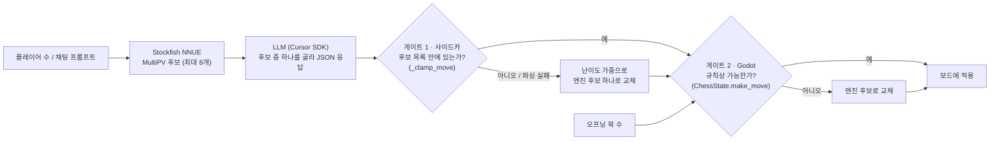

# Godot NNUE × Prompt Chess

**무엇:** 채팅(프롬프트)으로 오프닝·스타일을 지시하면 LLM이 상대 수를 고르는 Godot 4 체스입니다.  
**왜:** LLM이 고른 수를 그대로 믿지 않고, Stockfish MultiPV 후보에 있고 규칙상 가능한 수만 보드에 올리는 "게이트" 구조를 실제 게임 안에서 검증하려고 만들었습니다.  
**확인:** 아래 [게이트 동작 증거](#게이트-동작-증거) 스크린샷·로그를 보거나, `python ai_sidecar/test_gate.py`(API 키 없이 실행 가능)를 실행하면 됩니다.

Repo: [buc89l2nb41/GodotNnuePromptChess](https://github.com/buc89l2nb41/GodotNnuePromptChess)

---

## 게이트 흐름



- 게이트 1: [`ai_sidecar/server.py`](ai_sidecar/server.py)의 `_clamp_move`. LLM 응답의 UCI가 MultiPV 후보에 없으면(불법 수, 후보 밖 합법 수, 문장으로 답한 경우 모두) 후보 중 하나로 바꿉니다.
- 게이트 2: [`scripts/ai/move_gate.gd`](scripts/ai/move_gate.gd)의 `MoveGate.decide`. 보드 사본에 `ChessState.make_move`를 시도해 실패하면 엔진 후보로 바꿉니다. 오프닝 북 수는 MultiPV 밖일 수 있어서 이 단계만 거칩니다.
- 판정마다 `[GATE]` 로그가 한 줄씩 남습니다(사이드카는 `ai_sidecar/sidecar.log`, Godot은 콘솔). 채팅 패널에도 `게이트: AI 제안 ○○는 엔진 후보가 아니라 ○○로 교체`가 표시됩니다.

---

## 게이트 동작 증거

실제 게임 창, 실제 Stockfish 18, 실제 사이드카로 찍은 화면입니다. 백 `e2e4` 뒤 흑 AI의 답으로 `e8e1`(킹이 판을 가로지르는 불법 수)을 넣었고, 게이트가 MultiPV 후보 `e7e6`으로 바꿔 보드에 올렸습니다. 이때 LLM 답은 테스트용 주입(`AI_SIDECAR_INJECT_UCI`)으로 대신했으며, 그 뒤의 검사 경로는 실제 LLM 응답과 같은 함수를 씁니다.


같은 실행의 로그([`docs/logs/gate_demo_ingame.txt`](docs/logs/gate_demo_ingame.txt)):

```text
[GATE] REPLACED proposed=e8e1 applied=e7e6 candidates=e7e5,e7e6,c7c5,c7c6,b8c6,d7d6,g7g6,a7a6 fen=rnbqkbnr/pppppppp/8/8/4P3/8/PPPP1PPP/RNBQKBNR b KQkq e3 0 1 note=inject
[GATE] SIDECAR  REPLACED proposed=e8e1 applied=e7e6 (후보 밖)
[GATE] GODOT    PASS     proposed=e7e6 applied=e7e6 candidates=e7e5,e7e6,c7c5,c7c6,b8c6,d7d6,g7g6,a7a6 fen=rnbqkbnr/pppppppp/8/8/4P3/8/PPPP1PPP/RNBQKBNR b KQkq e3 0 1
```

테스트 결과(모두 실제 Stockfish MultiPV 후보 사용):

| 테스트 | 확인 내용 | 결과 |
|--------|-----------|------|
| [`ai_sidecar/test_gate.py`](ai_sidecar/test_gate.py) | 불법 수 `e1e8`, 후보 밖 합법 수 `g2g4`, 문장 답 `knight to f3` → 교체 / 후보 수 → 통과 | 4/4 통과 ([로그](docs/logs/gate_test_python.txt)) |
| [`agent_debug/scripts/run_gate_test.gd`](agent_debug/scripts/run_gate_test.gd) | Godot 규칙 게이트: 불법·파싱 불가 수 → 후보로 교체, 후보 수 → 통과, 보드 불변 (2개 포지션) | 12/12 통과 ([로그](docs/logs/gate_test_godot.txt)) |

### 직접 재현하기

API 키 없이 됩니다. Stockfish 배치(Quick Start 3단계)와 사이드카 패키지 설치(4단계의 `pip install`)만 필요합니다.

```powershell
# 1) 사이드카 게이트만 (Python)
cd ai_sidecar
python test_gate.py
```

```powershell
# 2) 실제 게임 창에서 교체 장면 캡처 (PNG + 콘솔 로그)
Godot_v4.6.2-stable_win64_console.exe --path . -s res://agent_debug/scripts/capture_gate_demo.gd -- --inject=e8e1
```

손으로 녹화하려면 PowerShell에서 `$env:AI_SIDECAR_INJECT_UCI = "e8e1"`을 설정한 뒤 같은 창에서 Godot을 실행하고, **상대: AI**, 플레이어=백으로 `e2e4`를 두면 됩니다. 흑이 둘 때마다 채팅 패널에 교체 메시지가 나옵니다. 실제 대국에서는 이 변수를 지워야 합니다.

### 한계

- 위 증거의 "LLM 오답"은 주입한 값입니다. 실제 LLM이 스스로 후보 밖 수를 낸 장면은 아직 따로 기록하지 않았습니다.
- LLM이 "오프닝 북 수"라고 답한 경우는 후보 목록 검사 없이 규칙 검사(게이트 2)만 거치므로, 합법이지만 약한 수가 올라갈 수 있습니다.

---

## 실행 방법 (Quick Start)

### 1) 필수 준비

| 항목 | 설명 |
|------|------|
| **Godot 4.6+** | [Godot 다운로드](https://godotengine.org/download) (에디터 또는 console 빌드) |
| **Stockfish** | [공식 다운로드](https://stockfishchess.org/download/) → `engine/stockfish/stockfish.exe` 에 배치 (Windows) |
| **Python 3.10+** | Prompt AI 상대 / 코칭용 (CPU만 둘 거면 생략 가능) |

> Stockfish 바이너리와 `.env`(API 키)는 **커밋하지 마세요.**

### 2) 저장소 클론

```bash
git clone https://github.com/buc89l2nb41/GodotNnuePromptChess.git
cd GodotNnuePromptChess
```

### 3) Stockfish 배치

1. [stockfishchess.org/download](https://stockfishchess.org/download/) 에서 OS에 맞는 빌드 받기  
2. 실행 파일을 아래 경로에 두기  

```text
GodotNnuePromptChess/engine/stockfish/stockfish.exe   # Windows
# Linux/macOS 예: engine/stockfish/stockfish
```

폴더가 없으면 `engine/stockfish/` 를 만든 뒤 넣으면 됩니다.

### 4) (선택) Prompt AI — 사이드카 1회 설치

채팅으로 오프닝을 지시하거나 PGN 코칭을 쓰려면:

```powershell
cd ai_sidecar
python -m venv .venv
.\.venv\Scripts\Activate.ps1
pip install -r requirements.txt
copy .env.example .env
```

`.env` 를 열어 **Cursor API 키**를 넣습니다.

- 키 발급: [Cursor Dashboard → Integrations](https://cursor.com/dashboard/integrations)
- 형식 예: `CURSOR_API_KEY=cursor_xxxxxxxx` (placeholder 조각이 남지 않게 한 줄로)

```env
CURSOR_API_KEY=cursor_xxxxxxxx
AI_SIDECAR_MOCK=0
CURSOR_AI_MODEL=composer-2.5
```

키 없이 UI만 확인할 때: `AI_SIDECAR_MOCK=1`

### 5) Godot에서 실행

1. Godot → **Import** → 이 프로젝트의 `project.godot` 선택  
2. **F5 (Play)**  
3. 상단 **상대** 버튼으로 모드 선택  
   - `OFF` — 혼자 / 편집  
   - `CPU` — Stockfish NNUE만  
   - `AI` — Prompt AI (사이드카 자동 기동) + NNUE 후보  

**상대: AI** 를 고르면 Godot이 `ai_sidecar`를 자동으로 켭니다. 보통 수동 `uvicorn`은 필요 없습니다.

에디터 없이 console로 실행하는 예:

```text
Godot_v4.x_win64_console.exe --path "C:\path\to\GodotNnuePromptChess"
```

### 6) 첫 대국 체크리스트

1. Stockfish 경로가 맞는지 확인 → **상대: CPU** 로 한 수 두기  
2. AI를 쓰려면 `.env` 키 설정 후 **상대: AI**  
3. 채팅에 예: `Sicilian Najdorf로 상대해줘` → 오프닝 북 로드  
4. FEN/PGN 칸에 기보 붙여넣기 → **보드에 적용** 또는 **코칭**

---

## 이 프로젝트가 하는 일

| 모드 | 누가 두나 | 특징 |
|------|-----------|------|
| **CPU** | Stockfish (NNUE) | Skill / movetime / depth로 난이도 |
| **AI (Prompt)** | Cursor AI가 MultiPV 후보 중 선택 | 채팅으로 오프닝·스타일·질문; 후보 밖·불법 수는 게이트에서 엔진 후보로 교체 |
| **코칭** | Cursor AI 해설 | PGN/FEN 붙여넣기 후 **코칭** — 보드는 최종 포지션으로 맞춤 |

핵심 원칙: **LLM이 임의로 둔 수는 보드에 바로 올리지 않습니다.**  
Stockfish 후보(또는 오프닝 북 UCI)만 적용하고, Godot `ChessState.make_move`가 최종 게이트입니다.

```text
플레이어 / 채팅(Prompt)
        │
        ▼
   Godot (보드 · 규칙)
        │
        ├── CPU:  Stockfish bestmove
        │
        └── AI:   Stockfish MultiPV 후보
                    → ai_sidecar (Cursor SDK)
                    → 선택·코칭 JSON
                    → 합법 수만 적용
```

---

## 주요 기능

### 체스 UI (Godot 4)

- SVG 기물, 클릭 이동, 승급 팝업  
- 새 게임 / 무르기 / 보드 편집 / 플레이어 색  

### Stockfish NNUE (CPU · AI 공통 엔진)

- UCI 직접 연동 (CPU 대전은 Python 불필요)  
- **Skill Level (0–20)** / **movetime(ms)** / **Max depth**  
- Lichess 스타일 **레벨 1–8** 프리셋  
- AI 모드에서는 **MultiPV**로 후보 수 수집  

### Prompt AI 상대 (`ai_sidecar`)

- 채팅 **전송**으로 오프닝·스타일·“왜 그 수야?” 질문  
- 수는 채팅에 자동 해설하지 않음 (물을 때만 답변)  
- 오프닝명은 **표준 영어** (검색·학습용)  
- Skill에 따라 후보를 **가중 선택** (항상 1위만 고집하지 않음)  
- Windows에서 Cursor SDK 브리지 호환 패치 포함  

### FEN / PGN

- 오른쪽 패널에 붙여넣기  
- **보드에 적용** — 포지션/기보를 보드에 반영 (변화수 `()` 스킵, 줄바꿈 있는 chess.com PGN 지원)  
- **코칭** — 보드 반영 + AI 해설 요청  

---

## 설정 (게임 내)

상단 **설정**:

- Skill (0..20)  
- movetime (ms)  
- MaxDepth (`0` = 제한 없음)  
- 레벨 1~8 프리셋  

값은 `user://settings.cfg`에 저장됩니다.

---

## 폴더 구조 (요약)

```text
GodotNnuePromptChess/
├── main.gd / main.tscn     # 메인 UI · 대국 루프
├── scripts/
│   ├── chess_state.gd      # 규칙 · FEN
│   ├── pgn_fen.gd          # FEN/PGN 로더
│   ├── engine/             # Stockfish UCI
│   └── ai/                 # 사이드카 HTTP · 프로세스 · move_gate.gd(규칙 게이트)
├── ai_sidecar/
│   ├── server.py           # FastAPI + Cursor SDK
│   ├── openings.py         # 북/Skill 헬퍼
│   ├── test_gate.py        # 후보 게이트 테스트 (키 불필요)
│   ├── .env.example
│   └── requirements.txt
├── engine/stockfish/       # stockfish.exe (직접 배치, 미포함 권장)
├── docs/                   # 게이트 증거 스크린샷 · 로그
└── agent_debug/            # 헤드리스·스모크 테스트 · 게이트 캡처
```

---

## AI 사이드카 수동 실행 (선택)

자동 기동이 안 될 때만:

```powershell
cd ai_sidecar
.\.venv\Scripts\Activate.ps1
uvicorn server:app --host 127.0.0.1 --port 8765
```

헬스 체크: `http://127.0.0.1:8765/health`

| Method | Path | 용도 |
|--------|------|------|
| GET | `/health` | 상태 |
| POST | `/session` | 세션 |
| POST | `/move` | 후보 중 수 선택 |
| POST | `/chat` | 대화 · 오프닝 · 코칭 |

자세한 내용은 [`ai_sidecar/README.md`](ai_sidecar/README.md) 참고.

---

## 테스트 (선택)

Godot console 경로를 `GODOT`에 두고:

```text
# 규칙/FEN
%GODOT% --headless --path "." -s "res://agent_debug/scripts/run_chess_tests.gd"

# PGN/FEN 로더
%GODOT% --headless --path "." -s "res://agent_debug/scripts/run_pgn_fen_test.gd"

# Stockfish 스모크
%GODOT% --headless --path "." -s "res://agent_debug/scripts/run_stockfish_bestmove_smoke_test.gd"

# 게이트 (Godot 규칙 게이트)
%GODOT% --headless --path "." -s "res://agent_debug/scripts/run_gate_test.gd"
```

사이드카 게이트: `cd ai_sidecar` 후 `python test_gate.py`

---

## 보안 · 라이선스 주의

- **`ai_sidecar/.env` 절대 커밋 금지** (API 키)  
- Stockfish는 [GPL](https://stockfishchess.org/) — 바이너리 재배포 시 라이선스 고지 필요. 이 레포는 **바이너리 미포함**을 권장합니다.  
- Cursor API 사용량·약관은 Cursor 정책을 따릅니다.

---

## 트러블슈팅

| 증상 | 확인 |
|------|------|
| CPU가 안 둠 | `engine/stockfish/stockfish.exe` 경로 · 설정에서 Skill/movetime |
| AI: 사이드카 연결 실패 | `ai_sidecar/.venv` + `pip install` · 포트 8765 · **상대: AI** 재선택 |
| 오프닝 조회 실패 / mock | `.env`의 `CURSOR_API_KEY`가 placeholder가 아닌지 |
| PGN 적용 오류 | chess.com 전체 PGN 붙여넣기 · 변화수 `()`는 본선만 적용됨 |
| Windows `os.get_blocking` | 최신 `ai_sidecar`(win_os_patch)인지 · Godot이 사이드카를 재시작했는지 |

---

## 로드맵에 가까운 사용 예

- 채팅: `Queen's Gambit Accepted로 상대해줘`  
- 채팅: `왜 그 수야?`  
- PGN 붙여넣기 → **코칭**  
- **상대: CPU** 로 NNUE만 연습, **AI** 로 프롬프트 대국
