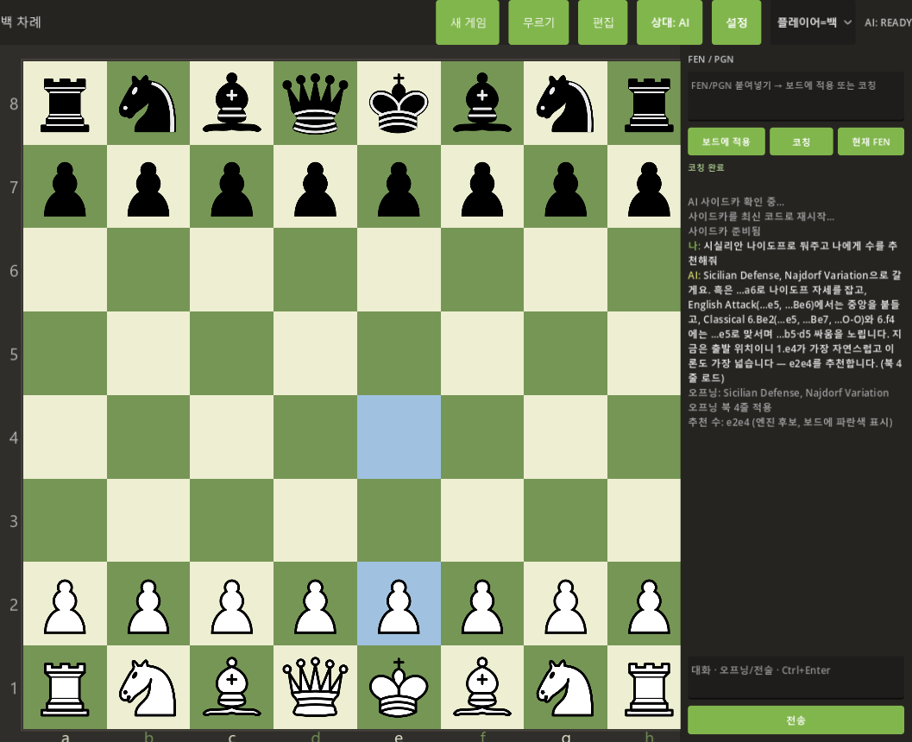
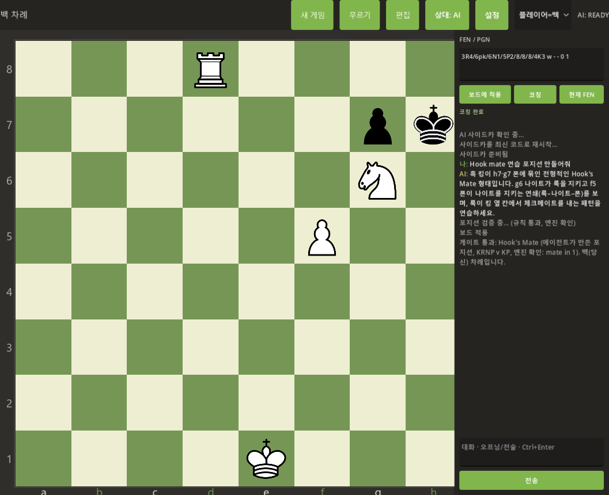
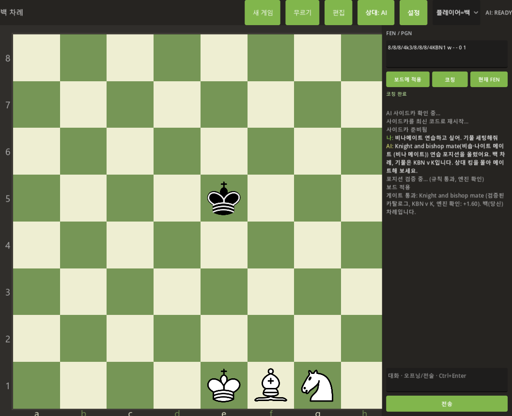
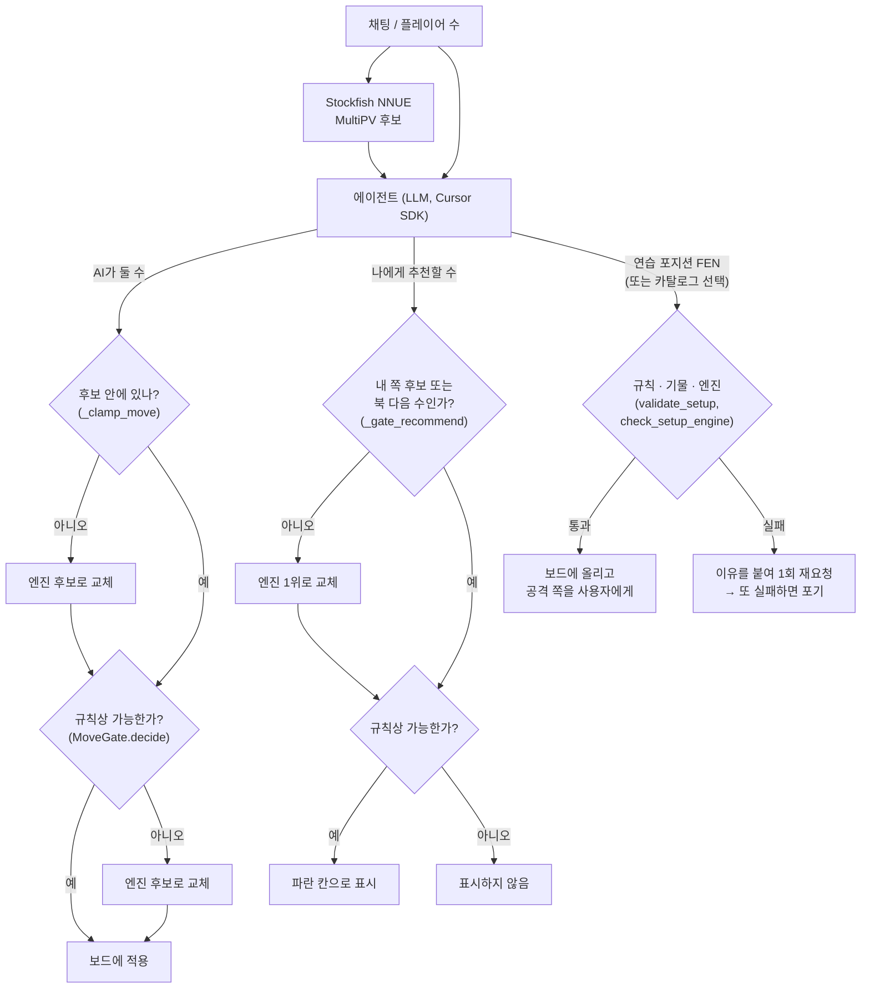
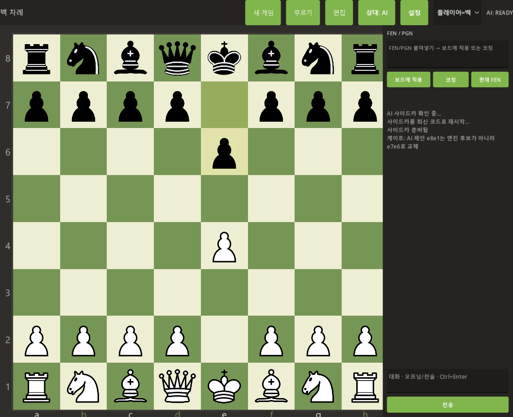

# Godot NNUE × Prompt Chess

**무엇:** 에이전트와 채팅하면서 두는 Godot 4 체스입니다. "시실리안 나이도프로 둬 주고 나에게 수를 추천해 줘", "비나 메이트 연습하게 기물 세팅해 줘"처럼 말하면 오프닝을 맞춰 두고, 내 수를 추천하고, 연습 포지션을 바로 보드에 올립니다.  
**왜:** LLM이 내놓는 수와 포지션은 틀릴 수 있습니다. 그래서 에이전트의 출력이 보드에 닿기 전에 Stockfish 후보와 체스 규칙으로 거르는 "게이트"를 함께 만들었습니다.  
**확인:** 아래 [실제 게임 화면](#에이전트와-할-수-있는-것)과 로그를 보거나, `python ai_sidecar/test_gate.py`(API 키 없이 실행 가능)를 실행하면 됩니다.

Repo: [buc89l2nb41/GodotNnuePromptChess](https://github.com/buc89l2nb41/GodotNnuePromptChess)

---

## 에이전트와 할 수 있는 것

| 채팅 예 | 하는 일 | 보드에 닿기 전 검사 |
|---------|---------|---------------------|
| `시실리안 나이도프로 둬 줘` | 오프닝 라인을 UCI 북으로 받아 AI가 그 수순으로 둡니다 | 북 수는 규칙 검사, 그 밖의 AI 수는 MultiPV 후보 + 규칙 검사 |
| `나에게 수를 추천해 줘` | 내 차례의 추천 수를 채팅과 보드(파란 칸)에 표시합니다 | 내 쪽 MultiPV 후보(또는 북의 다음 수) 안에 있어야 하고, 규칙상 가능해야 표시 |
| `비나 메이트 연습할래`, `룩 메이트`, `백랭크 메이트` | 연습 포지션을 바로 보드에 올리고, 내가 공격하는 쪽을 맡습니다 | 규칙(킹 수, 체크 상태 등) + 기물 구성 + 엔진 확인(메이트 수 / 우세) |
| `Hook mate 연습 포지션 만들어 줘` (목록에 없는 패턴) | 에이전트가 직접 FEN을 만듭니다 | 위와 같은 검사, 실패하면 이유를 붙여 1회 재요청 후 포기 |
| `왜 그 수야?` | 직전 AI 수의 이유를 설명합니다 | 설명만 하고 보드는 바꾸지 않음 |

### 실제 게임 화면

모두 실제 게임 창, Stockfish 18, 실제 사이드카로 찍었습니다. 맨 위 두 장은 실제 LLM(Cursor SDK) 응답입니다.

**오프닝 + 수 추천:** `시실리안 나이도프로 둬주고 나에게 수를 추천해줘`라고 보내면 Najdorf 북 4줄을 불러오고, 추천 수 `e2e4`가 두 게이트를 통과해 파란 칸으로 표시됩니다. 응답까지 12.7초 걸렸습니다([로그](docs/logs/agent_recommend.txt)).



**에이전트가 만든 포지션:** 카탈로그에 없는 `Hook mate`를 요청하면 에이전트가 FEN을 직접 만듭니다. 이 포지션은 규칙, 기물(KRNP v KP), 엔진 확인(mate in 1)을 통과한 뒤에만 보드에 올라갔습니다. 응답까지 70.7초 걸렸습니다([로그](docs/logs/setup_hook_agent.txt)).



**비나 메이트(KBN v K):** `비나메이트 연습하고 싶어. 기물 세팅해줘`라고 보내면 검증된 카탈로그 포지션이 1.97초 만에 올라갑니다. 엔진 평가는 +1.60입니다([로그](docs/logs/setup_kbn.txt)).



같은 방식으로 찍은 [룩 메이트](docs/images/setup_rook.png)([로그](docs/logs/setup_rook.txt))와 [백랭크 메이트](docs/images/setup_backrank.png)([로그](docs/logs/setup_backrank.txt)) 화면도 있습니다.

### 연습 포지션 카탈로그

[`ai_sidecar/practice_positions.json`](ai_sidecar/practice_positions.json)에 23개를 두었습니다. 패턴 이름은 Lichess Practice의 체크메이트 항목에서 쓰는 일반 명칭을 따랐고, 포지션은 직접 만들었습니다. 한국어·영어 별칭으로 찾고(`비나`, `투룩`, `백랭크`, `Boden's mate` 등), 목록에 없는 요청은 에이전트가 고르거나 새로 만듭니다.

- **기물 메이트 (11):** 퀸, 룩, 투 룩, 퀸·룩, 퀸·비숍, 퀸·나이트, 투 비숍, 비숍·나이트, 퀸 대 룩, 퀸 대 비숍, 퀸 대 나이트
- **메이트 패턴 (12, 모두 1수 메이트):** 백랭크, 스머더드, 아나스타샤, 아라비안, 보덴, 코너, 모피, 오페라, 다미아노, 롤리, 에폴렛, 그레코

`test_gate.py`가 23개 전부를 Stockfish로 확인합니다. 메이트 패턴은 엔진의 최선 수가 준비한 해답과 같고 mate in 1이어야 하며, 기물 메이트는 엔진이 메이트를 찾거나 +1.00 이상이어야 합니다. Godot 테스트는 같은 파일을 규칙 게이트에 통과시킵니다.

---

## 게이트 흐름



- 사이드카 쪽 검사는 [`ai_sidecar/server.py`](ai_sidecar/server.py)의 `_clamp_move`(AI 수)와 `_gate_recommend`(추천 수)가 합니다.
- Godot 쪽 검사는 [`scripts/ai/move_gate.gd`](scripts/ai/move_gate.gd)가 합니다. `decide`와 `is_legal_uci`로 수를, `validate_setup`과 `check_setup_engine`으로 포지션을 봅니다.
- 추천과 포지션 검증은 상대 난이도와 상관없이 Skill 20, 깊이 제한 없음으로 엔진을 돌립니다(`request_analysis_from_fen`).
- 판정마다 `[GATE]` 로그가 한 줄씩 남고(사이드카는 `ai_sidecar/sidecar.log`, Godot은 콘솔), 교체·거부 사실은 채팅 패널에도 표시됩니다.

---

## 게이트 동작 증거

**불법 수 교체:** 백 `e2e4` 뒤 흑 AI의 답으로 `e8e1`(킹이 판을 가로지르는 불법 수)을 넣었고, 게이트가 MultiPV 후보 `e7e6`으로 바꿔 보드에 올렸습니다. 실제 LLM이 이런 답을 내는 순간은 맞춰 찍기 어려워서, LLM 답은 테스트용 주입(`AI_SIDECAR_INJECT_UCI`)으로 대신했습니다. 그 뒤의 검사 경로는 실제 응답과 같은 함수를 씁니다.



```text
[GATE] REPLACED proposed=e8e1 applied=e7e6 candidates=e7e5,e7e6,c7c5,c7c6,b8c6,d7d6,g7g6,a7a6 fen=rnbqkbnr/pppppppp/8/8/4P3/8/PPPP1PPP/RNBQKBNR b KQkq e3 0 1 note=inject
[GATE] SIDECAR  REPLACED proposed=e8e1 applied=e7e6 (후보 밖)
[GATE] GODOT    PASS     proposed=e7e6 applied=e7e6 candidates=e7e5,e7e6,c7c5,c7c6,b8c6,d7d6,g7g6,a7a6 fen=rnbqkbnr/pppppppp/8/8/4P3/8/PPPP1PPP/RNBQKBNR b KQkq e3 0 1
```

([전체 로그](docs/logs/gate_demo_ingame.txt))

테스트 결과(실제 Stockfish 사용):

| 테스트 | 확인 내용 | 결과 |
|--------|-----------|------|
| [`ai_sidecar/test_gate.py`](ai_sidecar/test_gate.py) | AI 수 게이트 4건, 추천 수 게이트 6건, 카탈로그 23개 엔진 확인, 별칭 매칭 6건 | 39/39 통과 ([로그](docs/logs/gate_test_python.txt)) |
| [`agent_debug/scripts/run_gate_test.gd`](agent_debug/scripts/run_gate_test.gd) | 규칙 게이트(수) 12건, 포지션 규칙 거부/통과 6건, 엔진 확인 3건, 카탈로그 23개 규칙 통과 | 45/45 통과 ([로그](docs/logs/gate_test_godot.txt)) |

### 직접 재현하기

게이트 테스트와 불법 수 교체 장면은 API 키 없이 돌릴 수 있습니다. Stockfish 배치(Quick Start 3단계)와 사이드카 패키지 설치(4단계의 `pip install`)만 하면 됩니다. 에이전트 채팅 캡처에는 `.env`에 Cursor API 키가 있어야 합니다(카탈로그 포지션은 LLM을 부르지 않습니다).

```powershell
# 1) 사이드카 게이트 + 카탈로그 확인 (Python)
cd ai_sidecar
python test_gate.py
```

```powershell
# 2) 실제 게임 창에서 불법 수 교체 장면 캡처 (PNG + 콘솔 로그)
Godot_v4.6.2-stable_win64_console.exe --path . -s res://agent_debug/scripts/capture_gate_demo.gd -- --inject=e8e1
```

```powershell
# 3) 실제 게임 창에서 에이전트 채팅 캡처
Godot_v4.6.2-stable_win64_console.exe --path . -s res://agent_debug/scripts/capture_agent_chat.gd -- "--say=비나메이트 연습하고 싶어. 기물 세팅해줘" --out=res://docs/images/setup_kbn.png
```

### 한계

추천 게이트는 구조화된 추천 수(`recommend_uci`)만 거르기 때문에, 에이전트의 설명 문장에 다른 수가 섞이는 것까지 막지는 못합니다. 포지션 게이트는 규칙, 기물, 메이트/우세를 확인하지만 그 포지션이 요청한 패턴 이름과 정말 같은 모양인지는 판단하지 않습니다. 같은 이유로 LLM이 "오프닝 북 수"라고 답한 AI 수는 후보 검사 없이 규칙 검사만 거칩니다.

---

## 실행 방법 (Quick Start)

### 1) 필수 준비

| 항목 | 설명 |
|------|------|
| **Godot 4.6+** | [Godot 다운로드](https://godotengine.org/download) (에디터 또는 console 빌드) |
| **Stockfish** | [공식 다운로드](https://stockfishchess.org/download/) → `engine/stockfish/stockfish.exe` 에 배치 (Windows) |
| **Python 3.10+** | Prompt AI 상대 / 코칭용 (CPU만 둘 거면 생략 가능) |

> Stockfish 바이너리와 `.env`(API 키)는 **커밋하지 마세요.**

### 2) 저장소 클론

```bash
git clone https://github.com/buc89l2nb41/GodotNnuePromptChess.git
cd GodotNnuePromptChess
```

### 3) Stockfish 배치

1. [stockfishchess.org/download](https://stockfishchess.org/download/) 에서 OS에 맞는 빌드 받기  
2. 실행 파일을 아래 경로에 두기  

```text
GodotNnuePromptChess/engine/stockfish/stockfish.exe   # Windows
# Linux/macOS 예: engine/stockfish/stockfish
```

폴더가 없으면 `engine/stockfish/` 를 만든 뒤 넣으면 됩니다.

### 4) (선택) Prompt AI — 사이드카 1회 설치

채팅으로 오프닝을 지시하거나 PGN 코칭을 쓰려면:

```powershell
cd ai_sidecar
python -m venv .venv
.\.venv\Scripts\Activate.ps1
pip install -r requirements.txt
copy .env.example .env
```

`.env` 를 열어 **Cursor API 키**를 넣습니다.

- 키 발급: [Cursor Dashboard → Integrations](https://cursor.com/dashboard/integrations)
- 형식 예: `CURSOR_API_KEY=cursor_xxxxxxxx` (placeholder 조각이 남지 않게 한 줄로)

```env
CURSOR_API_KEY=cursor_xxxxxxxx
AI_SIDECAR_MOCK=0
CURSOR_AI_MODEL=composer-2.5
```

키 없이 UI만 확인할 때: `AI_SIDECAR_MOCK=1`

### 5) Godot에서 실행

1. Godot → **Import** → 이 프로젝트의 `project.godot` 선택  
2. **F5 (Play)**  
3. 상단 **상대** 버튼으로 모드 선택  
   - `OFF` — 혼자 / 편집  
   - `CPU` — Stockfish NNUE만  
   - `AI` — Prompt AI (사이드카 자동 기동) + NNUE 후보  

**상대: AI** 를 고르면 Godot이 `ai_sidecar`를 자동으로 켭니다. 보통 수동 `uvicorn`은 필요 없습니다.

에디터 없이 console로 실행하는 예:

```text
Godot_v4.x_win64_console.exe --path "C:\path\to\GodotNnuePromptChess"
```

### 6) 첫 대국 체크리스트

1. Stockfish 경로가 맞는지 확인 → **상대: CPU** 로 한 수 두기  
2. AI를 쓰려면 `.env` 키 설정 후 **상대: AI**  
3. 채팅에 예: `Sicilian Najdorf로 상대해줘` → 오프닝 북 로드, `수 추천해줘` → 파란 칸 표시, `룩 메이트 연습할래` → 연습 포지션  
4. FEN/PGN 칸에 기보 붙여넣기 → **보드에 적용** 또는 **코칭**

---

## 이 프로젝트가 하는 일

| 모드 | 누가 두나 | 특징 |
|------|-----------|------|
| **CPU** | Stockfish (NNUE) | Skill / movetime / depth로 난이도 |
| **AI (Prompt)** | Cursor AI가 MultiPV 후보 중 선택 | 채팅으로 오프닝·스타일·질문·수 추천·연습 포지션; 후보 밖·불법 수와 틀린 포지션은 게이트에서 교체·거부 |
| **코칭** | Cursor AI 해설 | PGN/FEN 붙여넣기 후 **코칭** — 보드는 최종 포지션으로 맞춤 |

핵심 원칙: **에이전트가 낸 수·추천·포지션은 보드에 바로 올리지 않습니다.** 흐름은 위 [게이트 흐름](#게이트-흐름)을 참고하세요.

---

## 주요 기능

### 체스 UI (Godot 4)

- SVG 기물, 클릭 이동, 승급 팝업  
- 새 게임 / 무르기 / 보드 편집 / 플레이어 색  

### Stockfish NNUE (CPU · AI 공통 엔진)

- UCI 직접 연동 (CPU 대전은 Python 불필요)  
- **Skill Level (0–20)** / **movetime(ms)** / **Max depth**  
- Lichess 스타일 **레벨 1–8** 프리셋  
- AI 모드에서는 **MultiPV**로 후보 수 수집  

### Prompt AI 상대 (`ai_sidecar`)

- 채팅 **전송**으로 오프닝·스타일·“왜 그 수야?” 질문  
- `수 추천해줘` → 내 차례 엔진 후보 안에서 추천, 보드에 파란 칸 표시  
- `○○ 메이트 연습` → 카탈로그 23개 또는 에이전트가 만든 포지션을 검증 후 보드에 세팅  
- 수는 채팅에 자동 해설하지 않음 (물을 때만 답변)  
- 오프닝명은 **표준 영어** (검색·학습용)  
- Skill에 따라 후보를 **가중 선택** (항상 1위만 고집하지 않음)  
- Windows에서 Cursor SDK 브리지 호환 패치 포함  

### FEN / PGN

- 오른쪽 패널에 붙여넣기  
- **보드에 적용** — 포지션/기보를 보드에 반영 (변화수 `()` 스킵, 줄바꿈 있는 chess.com PGN 지원)  
- **코칭** — 보드 반영 + AI 해설 요청  

---

## 설정 (게임 내)

상단 **설정**:

- Skill (0..20)  
- movetime (ms)  
- MaxDepth (`0` = 제한 없음)  
- 레벨 1~8 프리셋  

값은 `user://settings.cfg`에 저장됩니다.

---

## 폴더 구조 (요약)

```text
GodotNnuePromptChess/
├── main.gd / main.tscn     # 메인 UI · 대국 루프
├── scripts/
│   ├── chess_state.gd      # 규칙 · FEN
│   ├── pgn_fen.gd          # FEN/PGN 로더
│   ├── engine/             # Stockfish UCI
│   └── ai/                 # 사이드카 HTTP · 프로세스 · move_gate.gd(규칙 게이트)
├── ai_sidecar/
│   ├── server.py           # FastAPI + Cursor SDK
│   ├── openings.py         # 북/Skill 헬퍼 · 요청 종류 판별
│   ├── practice.py         # 연습 포지션 카탈로그 매칭
│   ├── practice_positions.json  # 메이트 패턴·기물 메이트 23개
│   ├── test_gate.py        # 후보 게이트 테스트 (키 불필요)
│   ├── .env.example
│   └── requirements.txt
├── engine/stockfish/       # stockfish.exe (직접 배치, 미포함 권장)
├── docs/                   # 게이트 증거 스크린샷 · 로그
└── agent_debug/            # 헤드리스·스모크 테스트 · 게이트 캡처
```

---

## AI 사이드카 수동 실행 (선택)

자동 기동이 안 될 때만:

```powershell
cd ai_sidecar
.\.venv\Scripts\Activate.ps1
uvicorn server:app --host 127.0.0.1 --port 8765
```

헬스 체크: `http://127.0.0.1:8765/health`

| Method | Path | 용도 |
|--------|------|------|
| GET | `/health` | 상태 |
| POST | `/session` | 세션 |
| POST | `/move` | 후보 중 수 선택 |
| POST | `/chat` | 대화 · 오프닝 · 코칭 · 수 추천 · 연습 포지션 |

자세한 내용은 [`ai_sidecar/README.md`](ai_sidecar/README.md) 참고.

---

## 테스트 (선택)

Godot console 경로를 `GODOT`에 두고:

```text
# 규칙/FEN
%GODOT% --headless --path "." -s "res://agent_debug/scripts/run_chess_tests.gd"

# PGN/FEN 로더
%GODOT% --headless --path "." -s "res://agent_debug/scripts/run_pgn_fen_test.gd"

# Stockfish 스모크
%GODOT% --headless --path "." -s "res://agent_debug/scripts/run_stockfish_bestmove_smoke_test.gd"

# 게이트 (Godot 규칙 게이트)
%GODOT% --headless --path "." -s "res://agent_debug/scripts/run_gate_test.gd"
```

사이드카 게이트: `cd ai_sidecar` 후 `python test_gate.py`

---

## 보안 · 라이선스 주의

- **`ai_sidecar/.env` 절대 커밋 금지** (API 키)  
- Stockfish는 [GPL](https://stockfishchess.org/) — 바이너리 재배포 시 라이선스 고지 필요. 이 레포는 **바이너리 미포함**을 권장합니다.  
- Cursor API 사용량·약관은 Cursor 정책을 따릅니다.

---

## 트러블슈팅

| 증상 | 확인 |
|------|------|
| CPU가 안 둠 | `engine/stockfish/stockfish.exe` 경로 · 설정에서 Skill/movetime |
| AI: 사이드카 연결 실패 | `ai_sidecar/.venv` + `pip install` · 포트 8765 · **상대: AI** 재선택 |
| 오프닝 조회 실패 / mock | `.env`의 `CURSOR_API_KEY`가 placeholder가 아닌지 |
| PGN 적용 오류 | chess.com 전체 PGN 붙여넣기 · 변화수 `()`는 본선만 적용됨 |
| Windows `os.get_blocking` | 최신 `ai_sidecar`(win_os_patch)인지 · Godot이 사이드카를 재시작했는지 |

---

## 로드맵에 가까운 사용 예

- 채팅: `Queen's Gambit Accepted로 상대해줘`  
- 채팅: `왜 그 수야?`  
- 채팅: `다음 수 뭐 둘까?`  
- 채팅: `보덴 메이트 연습할래`, `투룩 메이트`, `퀸 대 룩 엔딩 연습`  
- PGN 붙여넣기 → **코칭**  
- **상대: CPU** 로 NNUE만 연습, **AI** 로 프롬프트 대국
